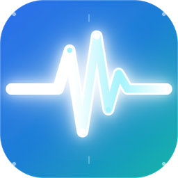

<div align="center">



# EngLab

### ⚡ Which engineer are you?

An engineering toolkit for university students. Pick your discipline and open a calculator or simulator built for the problems you actually solve in class.

[](https://houzcetin.github.io/EngLab/)


</div>

---

## 🧰 Six disciplines, six tools

| | Discipline | Tool | What it does |
|:-:|---|---|---|
| 🖥️ | **Computer Engineering** `CmpE` | **OS Scheduler Lab** | Simulates CPU scheduling and page replacement, then compares every algorithm on the same workload |
| ⚡ | **Electrical** `EE` | **Ohm's law** | Current and power from voltage and resistance, with a live circuit |
| ⚙️ | **Mechanical** `ME` | **Torque & power** | Angular velocity and power from torque and rpm, with meshing gears |
| 🏗️ | **Civil** `CE` | **Concrete slab** | Volume, bags of concrete and total weight, with an isometric drawing |
| 🧪 | **Chemical** `ChE` | **Ideal gas law** | Solves PV = nRT for whichever value you leave empty, with a particle box |
| 🔁 | **Anyone** `ALL` | **Unit converter** | Length, mass, pressure, energy and temperature, with a saved history |

## 🖥️ OS Scheduler Lab

The biggest tool, with two tabs.

**CPU scheduling**

- 🟦 Six algorithms: `FCFS` `SJF` `SRTF` `Priority` `Priority (P)` `Round Robin`
- 📊 Animated Gantt chart with idle time and a tick at every boundary
- ✏️ Editable process table (up to 10 processes) that recalculates as you type
- ⭐ "Every algorithm, same workload" comparison that stars the best average waiting time
- 📋 Per-process results: CT, TAT, WT and RT with averages

**Page replacement**

- 🟩 Three algorithms: `FIFO` `LRU` `Optimal`
- 🧱 Frame table that marks every fault `F` and hit `H`
- 📈 Faults vs frames chart for 1 to 7 frames
- ⚠️ Detects **Belady's anomaly** when FIFO gets worse with more memory

## ✨ Features

- 🚫 **No sign-up.** Open the page and start.
- 🔒 **Runs in your browser.** No backend; every calculation happens on your device.
- 🌗 **Light and dark mode.** Follows your system and remembers your choice.
- 📱 **Works on phones.** Fits screens down to 320 px wide.
- 🔗 **Shareable links.** Each tool has its own address, such as `#computer` or `#electrical`.
- ✅ **Built-in test cases.** Every tool has chips that load a textbook example and check the answer.
- ♿ **Accessible.** Labelled inputs, visible focus, reduced-motion support, and meaning never carried by color alone.

## 🚀 Run it locally

No install and no build. Clone the repository and open `index.html`:

```bash
git clone https://github.com/Houzcetin/EngLab.git
cd EngLab
```

Then double-click `index.html`, or serve the folder:

```bash
npx serve
```

## 🗂️ Project structure

```
EngLab/
├── index.html   → page shell, top bar, theme script
├── style.css    → design tokens and every component
├── app.js       → calculations, UI helpers, routing, tools
├── assets/      → logo and favicons
└── design/      → the original design system
```

`app.js` is organised in four sections:

1. **Pure calculations** with no DOM access: `ohmsLaw`, `torquePower`, `concreteSlab`, `idealGas`, `convertUnit`, `schedule`, `pageReplacement`
2. **UI helpers**
3. **Start screen, routing and theme**
4. **One render function per tool**

## 🧪 Tested against the textbook

The pure functions are exported for Node, and all 41 checks pass. A few of them:

| Test | Expected | Result |
|---|---|:-:|
| FCFS · P1(0,24) P2(0,3) P3(0,3) | average waiting 17 | ✅ |
| SRTF · P1(0,8) P2(1,4) P3(2,9) P4(3,5) | average waiting 6.5 | ✅ |
| Round Robin q=4 · P1(0,24) P2(0,3) P3(0,3) | average waiting 5.67 | ✅ |
| Classic reference string, 3 frames | FIFO 15, LRU 12, Optimal 9 faults | ✅ |
| `1 2 3 4 1 2 5 1 2 3 4 5` with FIFO | 9 faults with 3 frames, 10 with 4 | ✅ |
| 4 × 3 × 0.10 m slab | 1.2 m³, 100 bags | ✅ |
| 1 mol at 0 °C and 1 atm | 22.41 L | ✅ |

## 🎨 Palette

| Role | Color | Used for |
|---|---|---|
|  | **Primary** `#2B3E8A` | Brand, buttons, active tabs, charts |
|  | **Secondary** `#41E121` | Passed tests, best algorithm, page hits, live states |
|  | **Tertiary** `#FF4000` | Errors, page faults, warnings |
|  | **Neutral** `#494848` | Text, borders, greys |

Fonts: **Chakra Petch** for headings, **IBM Plex Sans** for body text, **IBM Plex Mono** for numbers and labels.

---

<div align="center">

Made by [Oğuz Çetin](https://github.com/Houzcetin)

</div>
